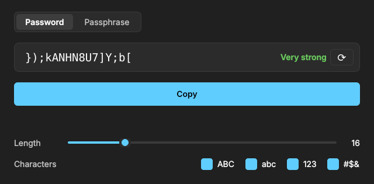
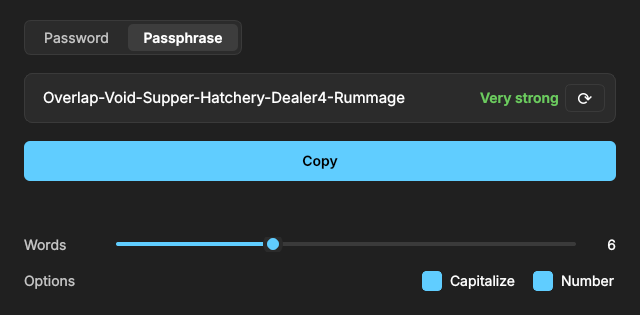

# Password Generator

A minimalist desktop app to generate secure passwords and passphrases,
with a Windows 11 dark mode look. It runs on Windows, Linux and macOS
(including Apple Silicon), and also works from the command line.

<p align="center">
  
  
</p>

## Features

- **Two modes:** random-character passwords or word-based passphrases.
- **Strength indicator:** shows how strong the result is (hover it to see the entropy in bits).
- **Copy with auto-clear:** the clipboard is cleared 20 seconds after copying, and when the app is closed.
- **Private:** works fully offline, stores nothing, and on Windows copied passwords are kept out of the clipboard history (Win+V).
- **Command line and Python library:** the same generator can be used from a terminal or from your own code.

## Installation

Requirements: Python 3.9 or later.

```bash
git clone https://github.com/1InIgO23/password-generator.git
cd password-generator

python -m venv .venv
# Windows (PowerShell)
.venv\Scripts\Activate.ps1
# Linux / macOS
source .venv/bin/activate

pip install -r requirements.txt
```

`requirements.txt` only contains PySide6, which is needed for the desktop app.
The command line and the library have no external dependencies.

## Using the app

```bash
python -m password_gui
```

### Password mode

Generates a password made of random characters.

- **Length:** drag the slider to choose between 4 and 64 characters.
- **Characters:** choose which character sets to use: uppercase (`ABC`),
  lowercase (`abc`), digits (`123`) and symbols (`#$&`). At least one must stay
  selected, and every selected set is guaranteed to appear in the password.

### Passphrase mode

Generates a passphrase made of random words, such as
`Lance-Deception-Pencil-Conflict-Engine-Rabid0`. Passphrases are easier to
remember and type than random characters, and just as secure with enough words.

- **Words:** choose between 3 and 12 words (6 by default).
- **Capitalize:** start every word with an uppercase letter.
- **Number:** add one digit to a random word.

Words are always separated by a hyphen, which almost every website accepts.

### Generating and copying

A new result is generated every time you change an option. Press **⟳** to get
another one with the same options. Each mode remembers its own settings when
you switch between them.

Press **Copy** to copy the result. A countdown shows when the clipboard will be
cleared:

<p align="center">
  
</p>

If you copy something else before the countdown ends, it is left untouched:
the app only clears the clipboard if it still holds the password it copied.

### Strength levels

The strength label is based on the entropy of the result, which measures how
many guesses an attacker would need (2<sup>bits</sup>):

| Label | Entropy |
|---|---|
| Weak | under 40 bits |
| Fair | 40 – 59 bits |
| Strong | 60 – 79 bits |
| Very strong | 80 bits or more |

## Command line

```bash
python -m password_core password --length 20 --symbols
python -m password_core passphrase --words 5 --capitalize --number
python -m password_core password --count 3 --entropy
python -m password_core passphrase --help
```

Results are written to stdout; the `--entropy` line goes to stderr, so
`python -m password_core password > out.txt` saves only the passwords.

## Using it as a library

```python
from password_core import Options, generate_password, pool_size, entropy_bits, strength_label

opts = Options(length=20, symbols=True, exclude_ambiguous=True)
pw = generate_password(opts)

bits = entropy_bits(opts.length, pool_size(opts))
print(pw, round(bits), strength_label(bits))
```

```python
from password_core import PassphraseOptions, generate_passphrase, passphrase_entropy_bits

opts = PassphraseOptions(words=6, separator="-", capitalize=True, add_number=True)
print(generate_passphrase(opts))          # e.g. Lantern-Oxidize-Crumb7-Velvet-Sprout-Ample
print(passphrase_entropy_bits(opts))      # ~83 bits
```

## Security decisions

- Randomness comes from `secrets`, which uses the operating system's CSPRNG.
- At least one character from each selected class is guaranteed.
- Nothing is stored and there is no network access.
- The clipboard is cleared automatically after copying and when the app closes.

## Project structure

```
password_core/     generator, passphrases, strength and CLI (no dependencies)
password_gui/      desktop app built with PySide6
tests/             unit tests for the core, the CLI and the GUI
docs/screenshots/  images used in this README
```

## Tests

```bash
python -m unittest -v
```

The GUI tests are skipped automatically if PySide6 is not installed.

## Credits

The passphrase wordlist is the [EFF Large Wordlist](https://www.eff.org/dice)
by the Electronic Frontier Foundation, licensed under
[CC BY 3.0](https://creativecommons.org/licenses/by/3.0/us/). The 4 hyphenated
words are dropped.

## AI
Please note that the development of this project was assisted by Artificial Intelligence (AI) tools, which were utilized to support code structuring, design implementation, and documentation refinement.
